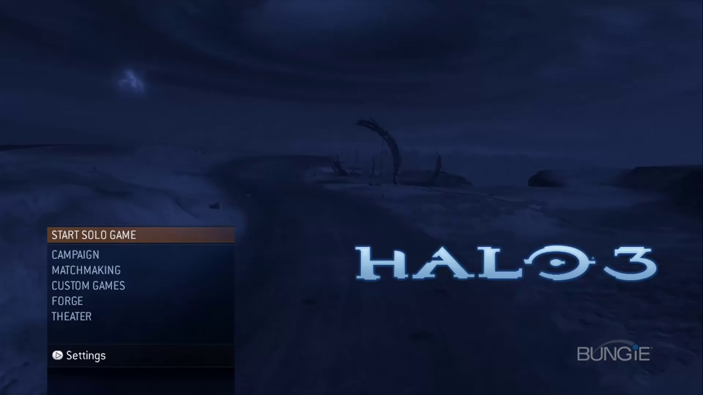
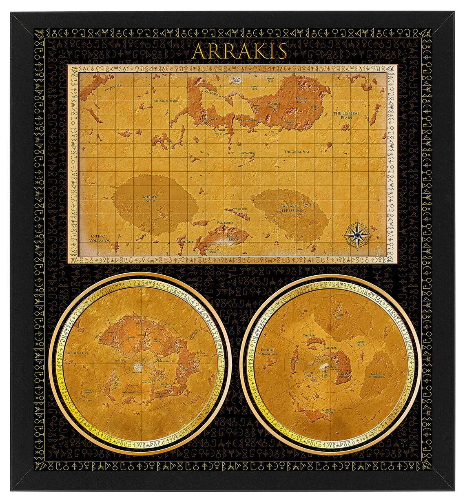
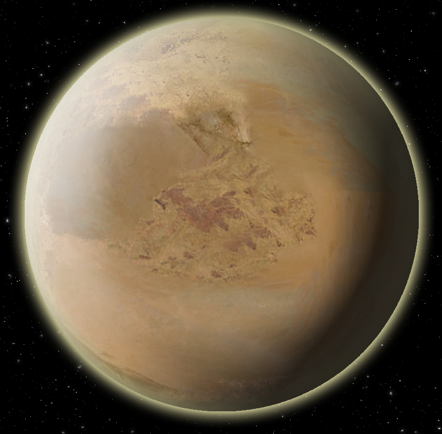

Next steps:
- Fix the styles of the home page:
    - Fitting a responsive to the size of the browser
    - Make the menu look like Halo menu 
    - the menu should be centered
- THREE.js scene:
    - add color the Arrakis planet, take for examplee these images:  
    - create two moons one bigger than the other, one is called the hand of god because it has marking on its surface that looks like a hand